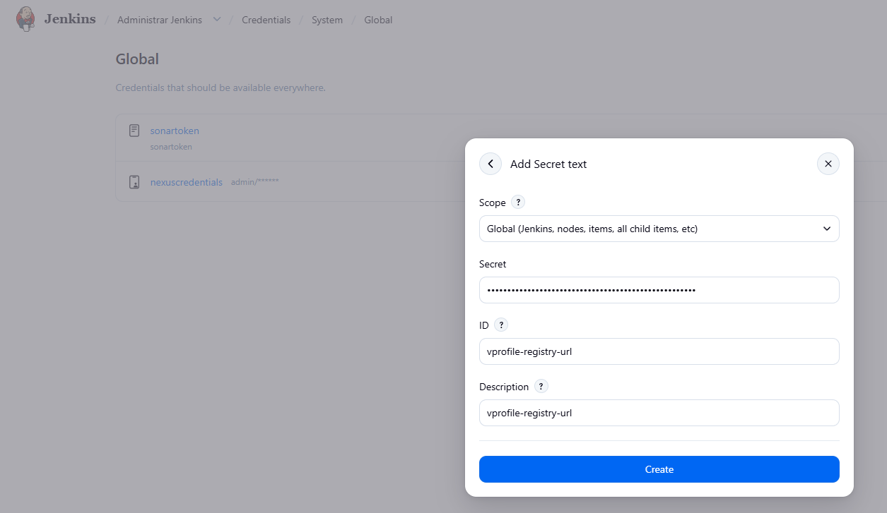
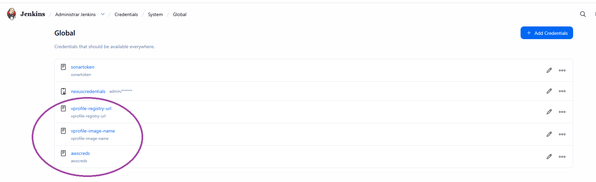

# Docker CI/CD Jenkins pipeline

In this section, we will provide a detailed explanation of how we implement Docker CI/CD automation for our web application on AWS using Jenkins.

# Docker CI/CD environment setup

The steps are pretty much the same as you did in [../jenkins/README.md](../jenkins/README.md), except that you don't need the Nexus server up and running, so follow the steps again and at the end of it, switch the Nexus server off.

# ECR repository setup

Once it is done, log in AWS and create an ECR repository:

Based on this, store three secrets that you will be using in the Jenkinsfile:

Next, create a new Jenkins pipeline using the provided  [../jenkins_files/Jenkinsfile_ecr](../jenkins_files/Jenkinsfile_ecr) file:

