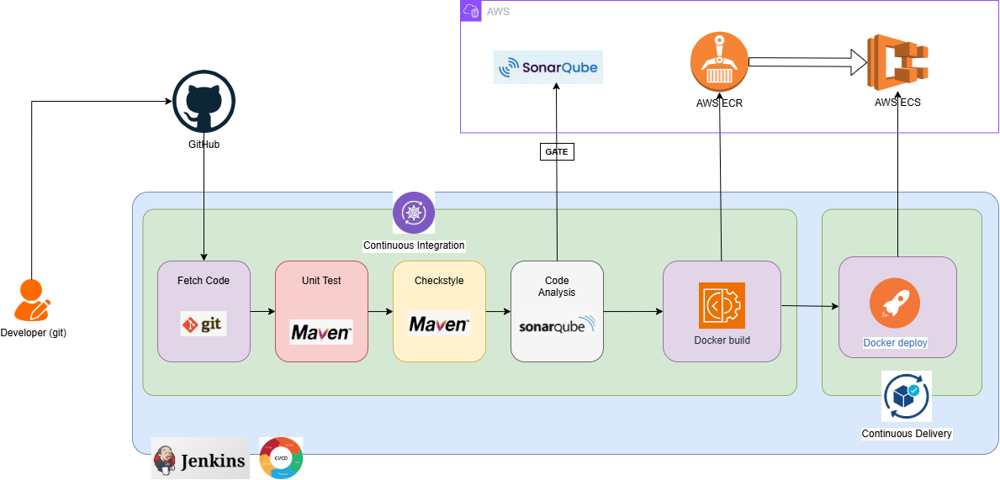
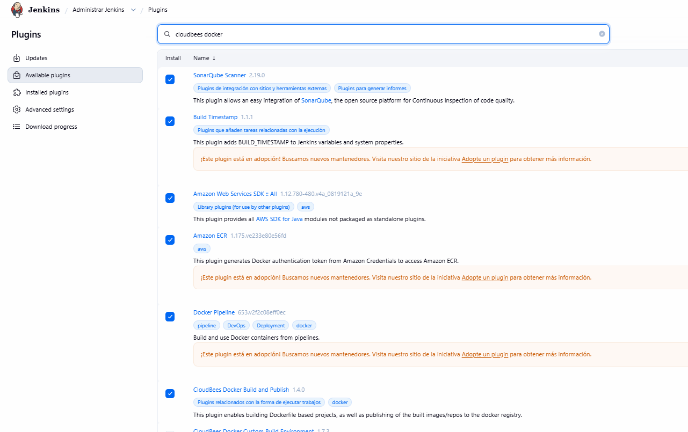
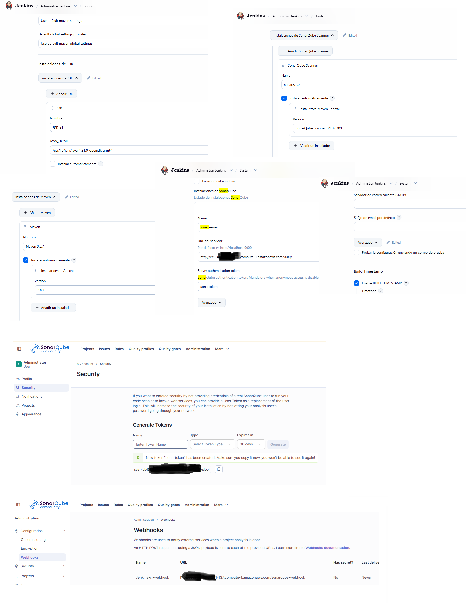
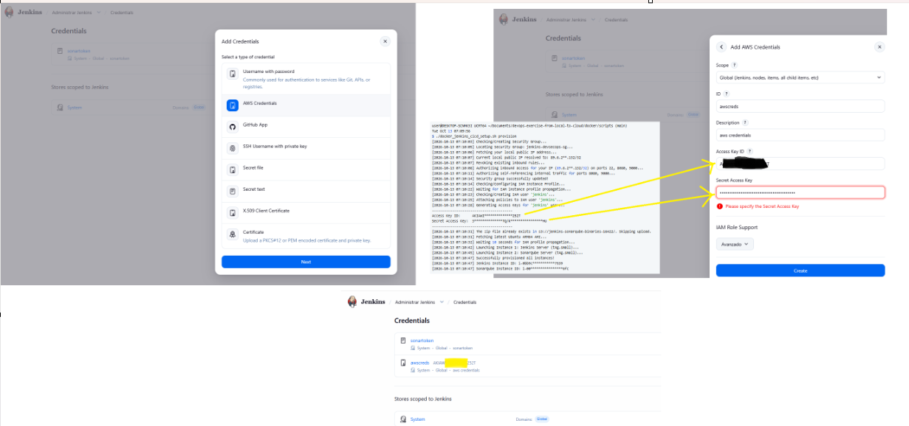
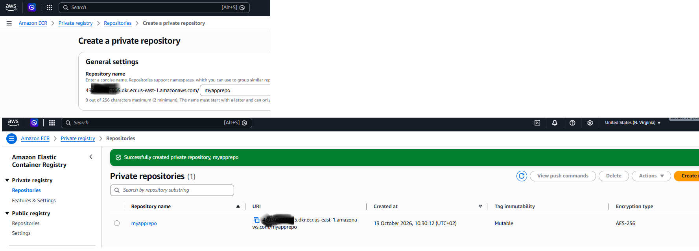
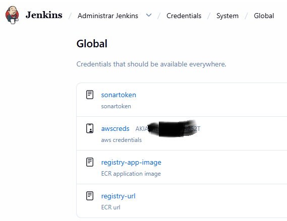
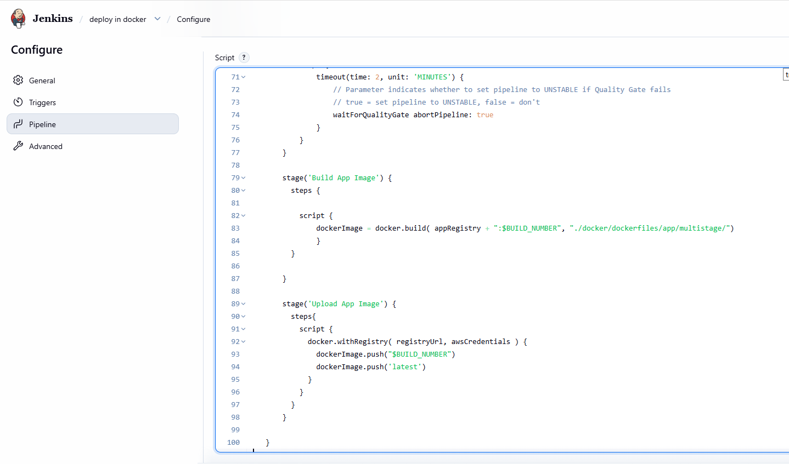
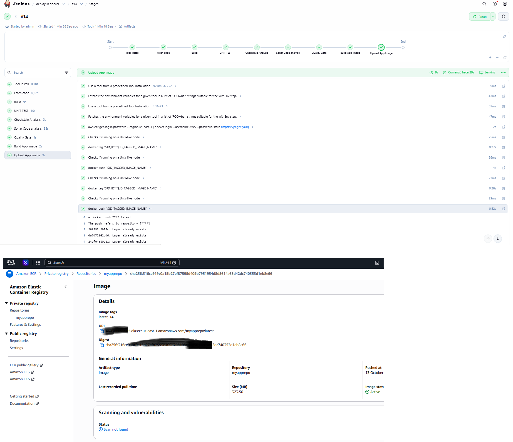
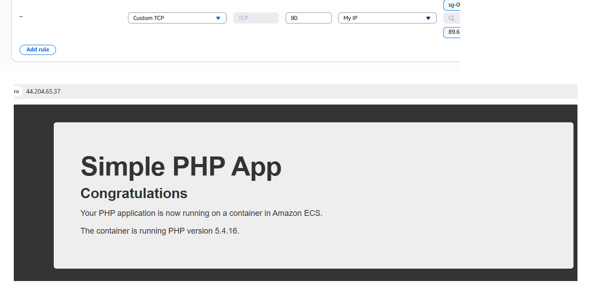

# Docker CI/CD Jenkins pipeline

In this section, we will provide a detailed explanation of how we implement Docker CI/CD automation for our web application on AWS using Jenkins.




# Docker CI/CD environment setup

The steps are pretty much the same as you did in [../jenkins/README.md](../jenkins/README.md), except that you don't need the Nexus server up and running so we will be spinning the Jenkins CI/CD infrastructure using the [scripts/docker_jenkins_cicd_setup.sh](scripts/docker_jenkins_cicd_setup.sh) script:

```bash
user@DESKTOP-SCNMK3I UCRT64 ~/Documents/devops-exercise-from-local-to-cloud/docker/scripts (main)
Tue Oct 13 07:09:56
$ ./docker_jenkins_cicd_setup.sh provision
[2026-10-13 14:08:23] Checking/Creating Security Group...
[2026-10-13 14:08:26] Locating Security Group: jenkins-devsecops-sg...
[2026-10-13 14:08:28] Fetching your local public IP address...
[2026-10-13 14:08:28] Current local public IP resolved to: 89.6.***.132/32
[2026-10-13 14:08:28] Revoking existing inbound rules...
[2026-10-13 14:08:30] Authorizing inbound access for your IP (89.6.***.132/32) on ports 22, 8080, 9000...
[2026-10-13 14:08:34] Authorizing self-referencing internal traffic for ports 8080, 9000...
[2026-10-13 14:08:36] Security group successfully updated!
[2026-10-13 14:08:36] Checking/Configuring IAM Instance Profile...
[2026-10-13 14:08:45] Waiting for IAM instance profile propagation...
[2026-10-13 14:08:46] Checking/Creating IAM user 'jenkins'...
[2026-10-13 14:08:48] Attaching policies to IAM user 'jenkins'...
[2026-10-13 14:08:50] Generating Access Keys for 'jenkins' user...
----------------------------------------
Access Key ID:      AKI******************AZ
Secret Access Key:  Xs*************************************bdE
----------------------------------------
[2026-10-13 14:08:51] Checking/Creating ECR Repository: myapprepo...
[2026-10-13 14:08:53] Creating ECS Cluster: devops-exercise-from-local-to-cloud...
[2026-10-13 14:08:55] Registering initial placeholder Task Definition: devops-exercise-from-local-to-cloud-task...
[2026-10-13 14:08:56] Creating ECS Service: devops-exercise-from-local-to-cloud-service...
[2026-10-13 14:09:01] The zip file already exists in s3://jenkins-sonarqube-binaries-16422/. Skipping upload.
[2026-10-13 14:09:01] Fetching latest Ubuntu ARM64 AMI...
[2026-10-13 14:09:02] Waiting 10 seconds for IAM profile propagation...
[2026-10-13 14:09:12] Launching Instance 1: Jenkins Server (t4g.small)...
[2026-10-13 14:09:15] Launching Instance 2: SonarQube Server (t4g.small)...
[2026-10-13 14:09:18] Successfully provisioned all instances, ECR, and ECS resources!
[2026-10-13 14:09:18] Jenkins Instance ID: i-0b96f40****4e68
[2026-10-13 14:09:18] SonarQube Instance ID: i-06e55*******8ef
```

Connect to the Jenkins url and install these plugins:

* Amazon Web Services SDK :: All
* AWS Credentials Plugin
* Build Timestamp Plugin
* CloudBees Docker Build and Publish plugin
* SonarQube Scanner for Jenkins



Continue with the configuration that you saw in [../jenkins/README.md](../jenkins/README.md), here shrunk in a small set of screenshots, go there for an extended explanation if required:



# ECR repository setup

This section covers the additional steps required to complete the Docker stage that we are going to add in this Jenkins pipeline.



Enter the AWS console and create an ECR repository:



Jenkins file will refer these three secrets that you need to store based in the above information:



Next, create a new Jenkins pipeline using the provided  [../jenkins_files/Jenkinsfile_ecr](../jenkins_files/Jenkinsfile_ecr) file:



Then run the Jenkins pipeline and verify that the docker image has been pushed to the AWS ECR:



Access the ECS container service, you will need to add access to your IP to the port 80:

