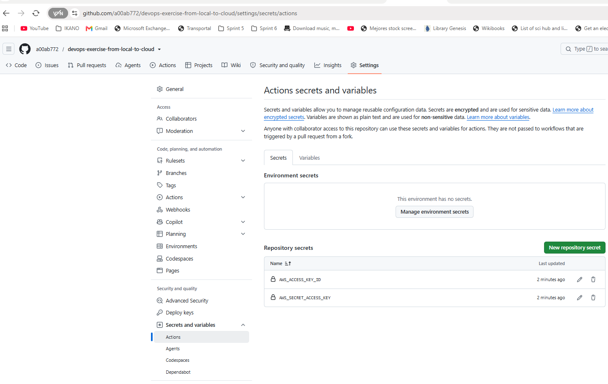
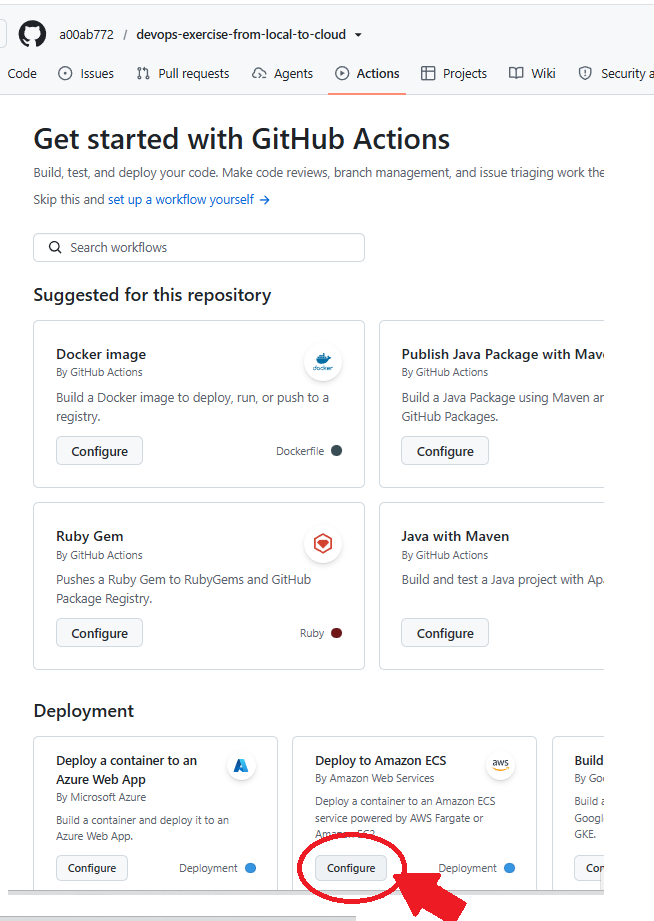
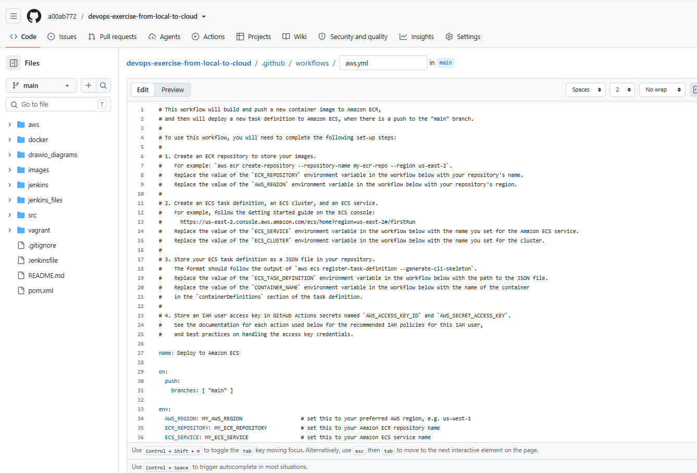
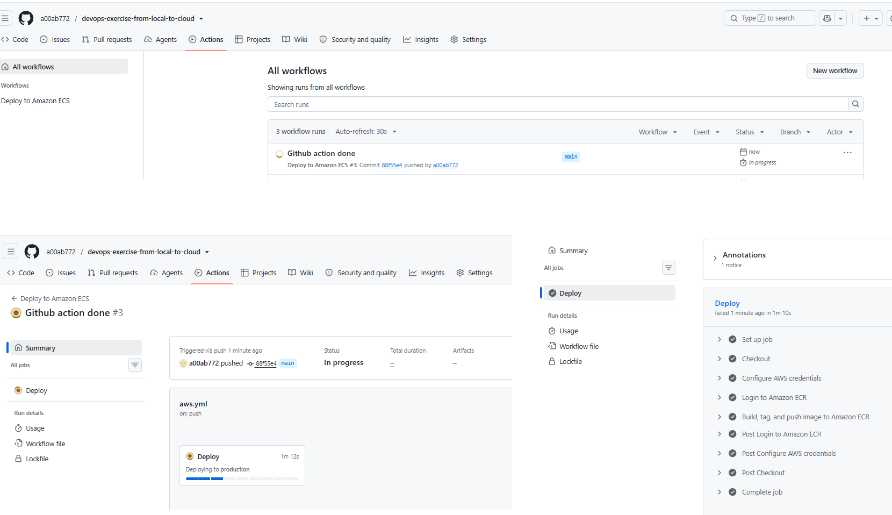

# Docker CI/CD GitHub actions workflow

Use the provided [scripts/setup_ghactions_aws.sh](scripts/setup_ghactions_aws.sh) to create ECR, ECS cluster, service, task definition, and IAM user that will be used in this GitHub Action:

```bash
user@DESKTOP-SCNMK3I UCRT64 ~/Documents/devops-exercise-from-local-to-cloud/github_actions/scripts (main)
Tue Oct 13 16:59:05
$ ./setup_ghactions_aws.sh
Usage: ./setup_ghactions_aws.sh {provision|teardown}

Options:
  provision : Creates ECR, ECS cluster, service, task definition, and IAM user for GitHub Actions.
  teardown  : Cleans up and deletes all created AWS resources (ECS, ECR, and IAM user).
```

Run it:

```bash
user@DESKTOP-SCNMK3I UCRT64 ~/Documents/devops-exercise-from-local-to-cloud/github_actions/scripts (main)
Wed Oct 14 07:20:32
$ ./setup_ghactions_aws.sh provision
[2026-10-14 07:20:44] 1. Creating ECR Repository: myapprepo...
[2026-10-14 07:20:46] 2. Creating ECS Cluster: devops-exercise-from-local-to-cloud...
[2026-10-14 07:20:48] 3. Registering initial placeholder Task Definition: devops-exercise-from-local-to-cloud-task...
[2026-10-14 07:20:49] 4. Creating ECS Service: devops-exercise-from-local-to-cloud-service...
[2026-10-14 07:20:53] 5. Creating IAM user for GitHub Actions: github-actions-deployer...
[2026-10-14 07:20:56] 6. Attaching required deployment policies...
[2026-10-14 07:20:59] 7. Generating Access Keys and updating GitHub Secrets automatically...
✓ Set Actions secret AWS_ACCESS_KEY_ID for a00ab772/devops-exercise-from-local-to-cloud
✓ Set Actions secret AWS_SECRET_ACCESS_KEY for a00ab772/devops-exercise-from-local-to-cloud
[2026-10-14 07:21:04] GitHub Secrets 'AWS_ACCESS_KEY_ID' and 'AWS_SECRET_ACCESS_KEY' successfully configured!
[2026-10-14 07:21:04] Provisioning complete!
```

The IAM user has been created and provided with proper permissions to interact with ECS:


The Github repository secrets has been generated and stored in your Github repo configuration:



Next, you can click in the Actions menu and click in the Deploy to Amazon ECS configuration button:



This is the result:



We actually will not create it as it is, instead we will use the [../.github/workflows/aws.yml](../.github/workflows/aws.yml) github actions yaml file that I have tailored from the above generated code, to make use of the github variables that the script created and stored on our behalf.

Additionally we create the [../task-definition.json](../task-definition.json) to be used by the GitHub action.

After we push the code changes the GitHub acction is triggered and the deployment to ECS happens exactly the same as we saw with Jenkins:



As usual, teardown the lab and make sure that no ECS, ECR, or any unwanted component remains in your AWS account:

```bash
user@DESKTOP-SCNMK3I UCRT64 ~/Documents/devops-exercise-from-local-to-cloud/github_actions/scripts (main)
Wed Oct 14 08:16:12
$ ./setup_ghactions_aws.sh teardown
[2026-10-14 08:17:07] 1. Cleaning up ECS Service and Cluster...
[2026-10-14 08:17:13] 2. Deregistering ECS Task Definitions...
[2026-10-14 08:17:14] Deregistering task definition: arn:aws:ecs:us-east-1:43*********5:task-definition/devops-exercise-from-local-to-cloud-task:5
[2026-10-14 08:17:16] Deregistering task definition: arn:aws:ecs:us-east-1:43*********5:task-definition/devops-exercise-from-local-to-cloud-task:6
[2026-10-14 08:17:18] 3. Cleaning up ECR Repository (myapprepo)...
[2026-10-14 08:17:19] 4. Cleaning up IAM User (github-actions-deployer)...
[2026-10-14 08:17:31] Teardown complete!
```