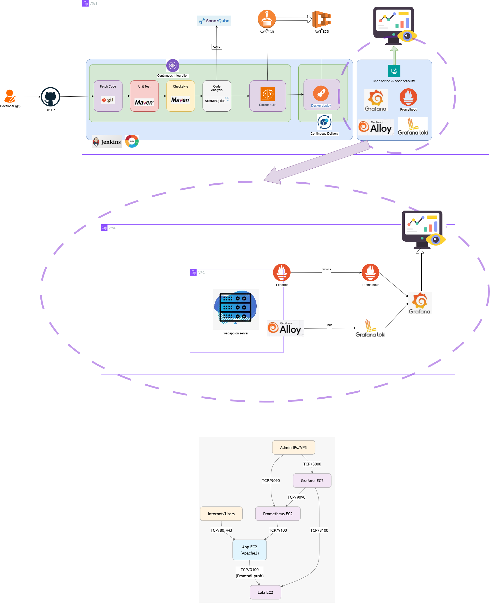
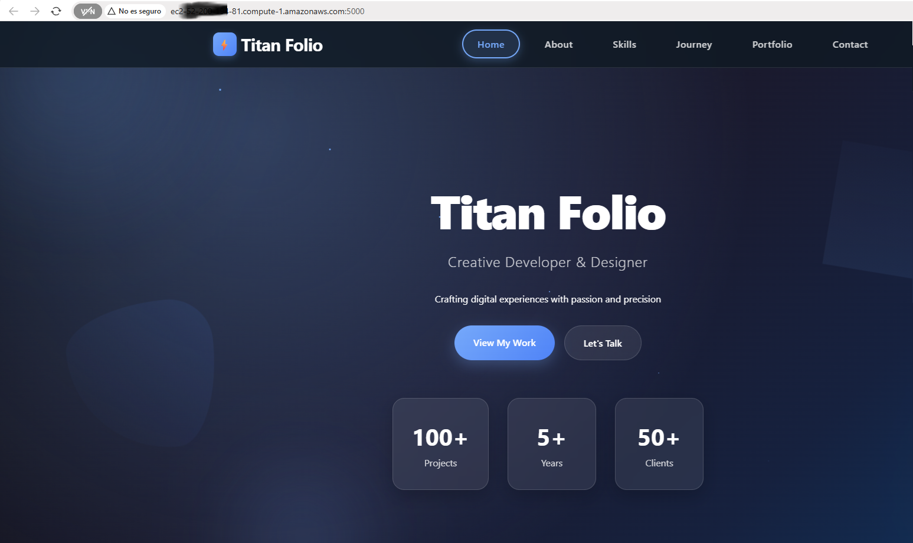
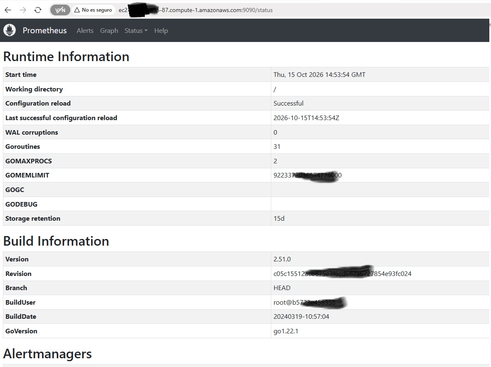
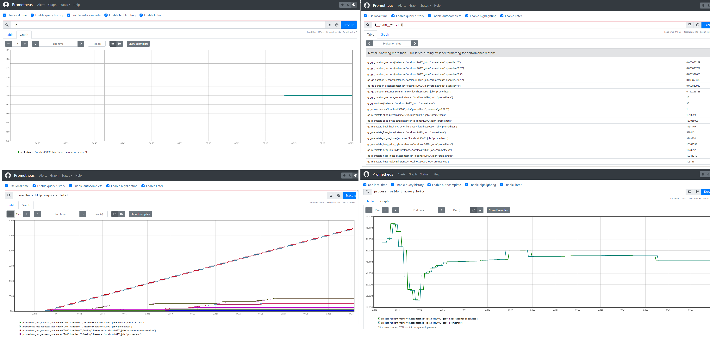
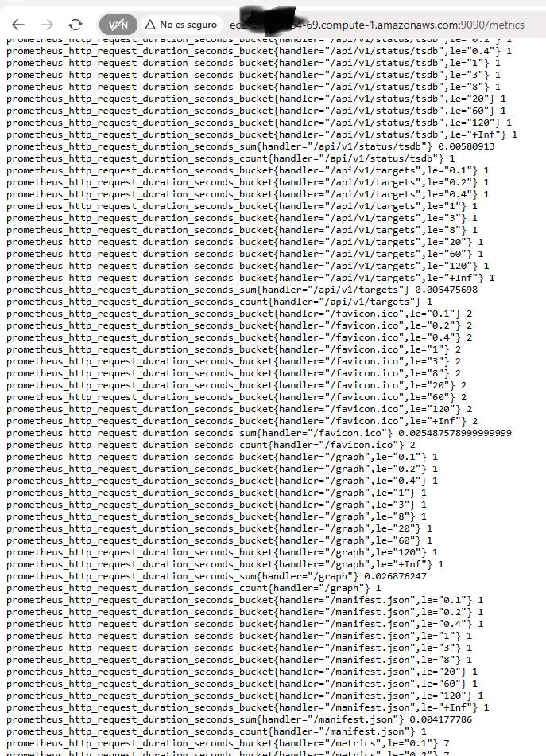
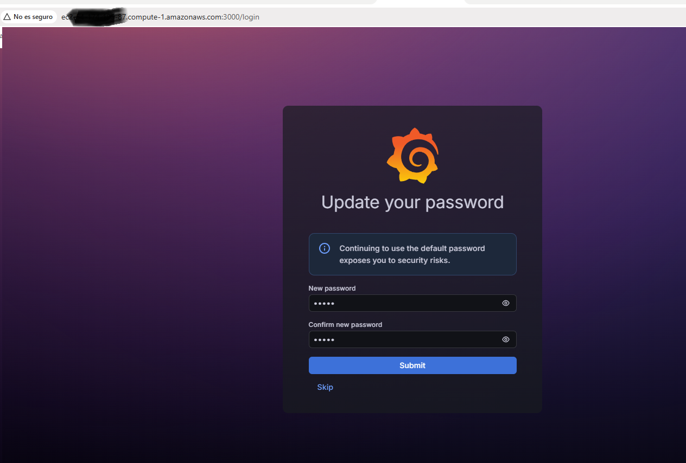
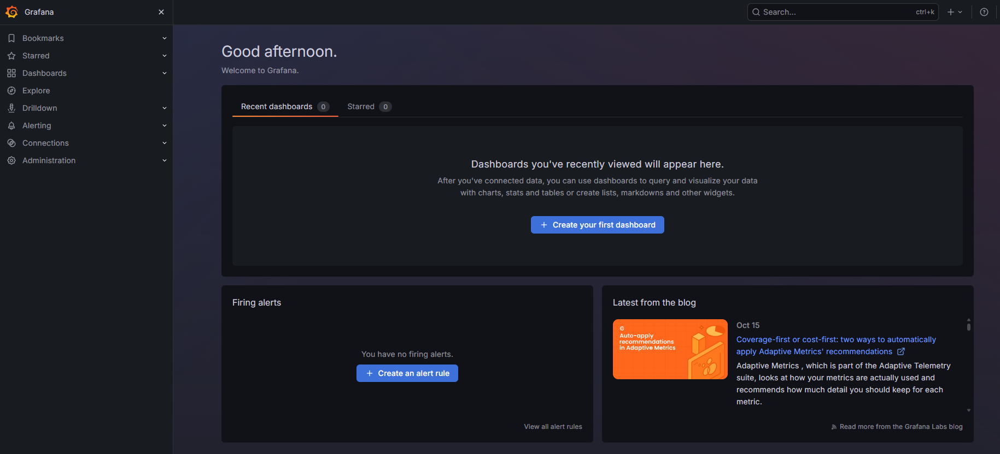

# Monitoring and Observability layers

There are 7 layers of monitoring:

1. Browser / Frontend Monitoring (Real User Monitoring - RUM)
2. Backend / Application Performance Monitoring (APM)
3. Infrastructure Monitoring
4. Synthetic Monitoring
5. Business / KPI Monitoring
6. Log Monitoring
7. Security Monitoring

Each monitoring layer serves a specific and complementary function, covering everything from user experience to security and business performance.

Integrating all these layers provides a comprehensive and proactive view of system health and reliability.

## 1. Browser / Frontend Monitoring (Real User Monitoring - RUM)

This layer focuses in real user experience, for example: "Track checkout page load time for users in Sweden".

* Metrics collected in this layer: 

  * Page load time (TTFB, FCP),
  * Core Web Vitals (LCP, FID, CLS),
  * JavaScript errors,
  * user navigation & clicks.

* Tools used in this layer:

  * Datadog RUM,
  * New Relic Browser,
  * Sentry,
  * Pingdom RUM.

## 2. Backend / Application Performance Monitoring (APM)

This layer focuses in Backend code and APIs, for example: "Trace API latency from NGINX to Java to MySQL".

* Metrics collected in this layer:

  * Response time,
  * throughput,
  * error rate,
  * database query performance,
  * external API latency,
  * end-to-end tracing.
  
* Tools used in this layer:

  * New Relic,
  * Datadog APM,
  * AppDynamics,
  * Dynatrace,
  * Elastic APM.

## 3. Infrastructure Monitoring

This layer focuses in servers, containers, and cloud resources, for example: "Alert when EC2 CPU usage exceeds 90% for 5 minutes".

* Metrics collected in this layer:

  * CPU,
  * memory,
  * disk,
  * network usage,
  * node health,
  * uptime,
  * pod/container status (Kubernetes)

* Tools used in this layer:

  * Prometheus + Grafana,
  * CloudWatch,
  * Datadog Infra,
  * Zabbix,
  * Nagios.

## 4. Synthetic Monitoring

This layer focuses in proactive performance and availability testing, for example: "Simulate user login from New York and London every 10 minutes".

* Types of synthetic metrics that business usually monitor are:

  * Availability checks (HTTP 200),
  * transaction flows (login to checkout),
  * API endpoint testing.

* Tools used in this layer:

  * Pingdom,
  * Checkly,
  * Datadog Synthetics,
  * CloudWatch Canaries.

## 5. Business / KPI Monitoring

This layer focuses in business performance metrics, for example: "Alert when checkout success rate drops below 95%".

* Metrics collected in this layer:

  * Signups per minute,
  * conversion rate,
  * failed payments,
  * daily active users.

* Tools used in this layer:

  * Mixpanel,
  * Amplitude,
  * Google Analytics,
  * Datadog (custom metrics).

## 6. Log Monitoring

This layer focuses in error detection, debugging, and trend analysis, for example: "Detect spike in TimeoutException logs after deployment".

* Metrics collected in this layer:

  * Error frequency,
  * request logs (status codes),
  * authentication failures.

* Tools used in this layer:

  * ELK Stack,
  * Loki + Grafana,
  * Splunk,
  * CloudWatch Logs.

## 7. Security Monitoring

This layer focuses in threat detection and compliance, for Example: "Detect login anomalies or suspicious access attempts".

* Metrics collected in this layer:

  * Unauthorized access attempts,
  * IAM anomalies,
  * intrusion detection.

* Tools used in this layer:

  * AWS GuardDuty,
  * Datadog Security,
  * Splunk Security,
  * Wazuh.

# Monitoring and Observability environment architecture

The components that we will spin this lab are pretty much the same as you did in [../docker/README.md](../docker/README.md), but in addition we will spin up a Prometheus + Grafana EC2 instance, this is the architectural diagram:



# Monitoring and Observability environment setup

 You can spin it up using the provided [scripts/docker_jenkins_cicd_monitoring_setup.sh](scripts/docker_jenkins_cicd_monitoring_setup.sh) script:

```bash
user@DESKTOP-SCNMK3I UCRT64 ~/Documents/devops-exercise-from-local-to-cloud/monitoring-and-observability/scripts (main)
Thu Oct 15 15:56:15
$ ./docker_jenkins_cicd_monitoring_setup.sh
Usage: ./docker_jenkins_cicd_monitoring_setup.sh {provision [jenkins|sonarqube|prometheus]|teardown [jenkins|sonarqube|prometheus]|update-ip}

Options:
  provision  : Deploys IAM roles, S3 bucket, Security Group, ECR, and ECS resources.
               You can specify individual servers to spin up: jenkins, sonarqube, prometheus.
               Note: Provisioning 'prometheus' also spins up the stress micro instance forwarding metrics/logs.
  teardown   : Terminates EC2 instances and cleans up resources.
               You can specify an individual server to teardown: jenkins, sonarqube, prometheus.
  update-ip  : Fetches your local machine's current public IP via curl,
               clears out stale ingress rules in the Security Group, and
               authorizes the new IP (ports 22, 3000, 8080, 9000, 9090) plus
               self-referencing traffic between instances.
```

```bash
user@DESKTOP-SCNMK3I UCRT64 ~/Documents/devops-exercise-from-local-to-cloud/monitoring-and-observability/scripts (main)
Thu Oct 15 15:57:54
$ ./docker_jenkins_cicd_monitoring_setup.sh provision
[2026-10-15 16:15:00] Verifying AWS CLI authentication using profile 'default'...
[2026-10-15 16:15:01] AWS authentication successful.
[2026-10-15 16:15:01] Checking/Creating Security Group...
[2026-10-15 16:15:05] Verifying AWS CLI authentication using profile 'default'...
[2026-10-15 16:15:07] AWS authentication successful.
[2026-10-15 16:15:07] Locating Security Group: jenkins-devsecops-sg...
[2026-10-15 16:15:08] Fetching your local public IP address...
[2026-10-15 16:15:08] Current local public IP resolved to: 89.6.2**.132/32
[2026-10-15 16:15:08] Revoking existing inbound rules...
[2026-10-15 16:15:10] Authorizing inbound access for your IP (89.6.2**.132/32) on ports 22, 3000, 8080, 9000, 9090...
[2026-10-15 16:15:17] Authorizing self-referencing internal traffic for ports 3000, 8080, 9000, 9090...
[2026-10-15 16:15:23] Security group successfully updated!
[2026-10-15 16:15:23] Checking/Configuring IAM Instance Profile...
[2026-10-15 16:15:32] Waiting for IAM instance profile propagation...
[2026-10-15 16:15:33] Checking/Creating IAM user 'jenkins'...
[2026-10-15 16:15:35] Attaching policies to IAM user 'jenkins'...
[2026-10-15 16:15:38] Generating Access Keys for 'jenkins' user...
----------------------------------------
Access Key ID:      AKIA**********QJRFF
Secret Access Key:  rq4vi7***********Jdj8l8/H
----------------------------------------
[2026-10-15 16:15:39] Checking/Creating ECR Repository: myapprepo...
[2026-10-15 16:15:41] Creating ECS Cluster: devops-exercise-from-local-to-cloud...
[2026-10-15 16:15:42] Registering initial placeholder Task Definition: devops-exercise-from-local-to-cloud-task...
[2026-10-15 16:15:43] Creating ECS Service: devops-exercise-from-local-to-cloud-service...
[2026-10-15 16:15:48] The zip file already exists in s3://jenkins-sonarqube-binaries-16422/. Skipping upload.
[2026-10-15 16:15:48] Fetching latest Ubuntu ARM64 AMI...
[2026-10-15 16:15:50] Waiting 10 seconds for IAM profile propagation...
[2026-10-15 16:16:00] Launching Instance 1: Jenkins Server (t4g.small)...
[2026-10-15 16:16:03] Launching Instance 2: SonarQube Server (t4g.small)...
[2026-10-15 16:16:05] Launching Instance 3: Prometheus & Grafana Server (t4g.micro)...
[2026-10-17 07:19:40] Launching Conditional Instance: Stress Micro Server (t4g.micro)...
[2026-10-17 07:19:43] Stress Instance ID: i-0926*******8b82b
[2026-10-15 16:16:08] Successfully provisioned all instances, ECR, and ECS resources!
[2026-10-15 16:16:08] Jenkins Instance ID: i-09***********32c
[2026-10-15 16:16:08] SonarQube Instance ID: i-0cb***********5a8
[2026-10-15 16:16:08] Prometheus & Grafana Instance ID: i-0b01***********e39
```

The stress web application that we will monitor can be accessed from the stress instance public ip on port 5000:



Let's access the Prometheus public IP (port 9090):



We can use the [PromQL](https://promlabs.com/promql-cheat-sheet/) for common metrics:

* up
* {__name__=~".+"}
* scrape_samples_scraped
* scrape_duration_seconds
* prometheus_http_requests_total
* process_cpu_seconds_total
* process_resident_memory_bytes
* ...



You can see all the metrics collected by Prometheus via the /metrics end point:



Let's access the Grafana public IP, default username and password is `admin`:





(WIP)